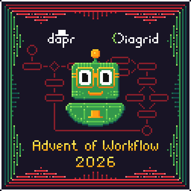

# Advent of Workflow


Join the Advent of Workflow, learn about building durable workflows with Dapr and Diagrid and win prizes!

Twelve Dapr Workflow challenges, one every other day from 1 to 23 December 2026. Run by [Diagrid](https://www.diagrid.io), open to everyone!

North Pole Station has run on TINSEL — Tracking, Inventory, Scheduling and Elf Logistics — since 1957, and the old mainframe is finally failing: it drops jobs halfway through and keeps no record that they ever started. It cannot be taken down for repair, because the launch window does not move. So the station is being rebuilt one subsystem at a time, as durable workflows, and that is what each challenge asks you to build. Read the full story [here](STORY.md).

Register and read the rules here: [diagrid.io/advent-of-workflow](https://diagrid.io/advent-of-workflow).

## How it works

1. Register on [diagrid.io](https://diagrid.io/advent-of-workflow). Your email is required to get the digital award and to contact the winners of the two LEGO® Game Boy™ sets. Challenges are emailed to you and also published here as GitHub issues.
2. **Fork this repo** and do the setup below.
3. For each challenge, build the workflow app in your fork, one directory or branch per challenge (for example `challenge-01/`).
4. Run it on Dapr OSS, watch the run in the Dapr Dev Dashboard and screenshot the workflow run detail page. Optionally, run it with Diagrid and screenshot the workflow diagram.
5. Open a [submission issue](https://github.com/diagrid-labs/advent-of-workflow-leaderboard/issues/new?template=submission.yml) in the [leaderboard repo](https://github.com/diagrid-labs/advent-of-workflow-leaderboard/): pick the challenge number, link your work and drag the screenshot into the issue. One issue per challenge.
6. You get a pass or a fail. Rank is the number of challenges you pass.

## Dates

Challenges drop on 1, 3, 5, 7, 9, 11, 13, 15, 17, 19, 21 and 23 December 2026.

- Submissions close **Sunday 3 January 2027, 23:59 CET**, so the holidays are yours to catch up.
- Results are announced **Wednesday 13 January 2027**.

You can start late. Rank is a count of passes, not of when you started, so a late joiner can still climb until submissions close.

## Prizes

- A digital **[Holopin](https://www.holopin.io/)** award for passing all twelve challenges. You can earn it on Dapr OSS alone.

  

- Two **LEGO Game Boy** sets: These are awarded to whoever ran the most optional steps in the challenges that use Diagrid. If more than two participants have the same amount of Diagrid-based implementations, two random winners will be chosen from this group.

> Diagrid staff and Dapr maintainers are excluded from prizes. The full rules and the winner criteria are on the landing page.
>
> LEGO® is a trademark of the LEGO Group. Game Boy™ is a trademark of Nintendo. Neither sponsors, endorses or is connected with Advent of Workflow.

## What you need

### 1. Dapr 1.19 or newer

Install the Dapr CLI and initialise Dapr locally by following the [Dapr docs](https://docs.dapr.io/getting-started/install-dapr-cli/).

```sh
dapr --version
dapr init
```

`dapr init` needs Docker (or Podman) running. Check that the CLI and runtime report 1.19 or higher.

### 2. A toolchain for your language of choice

Any language Dapr Workflow supports works: .NET, Java, Python, Go and JavaScript/TypeScript. Install the toolchain for the one you pick. See [Languages](#languages) below.

### 3. The Dapr Dev Dashboard (local, free, no account required)

The [Dapr Dev Dashboard](https://github.com/diagridio/dev-dashboard) is a local tool that runs on your machine and shows your workflow runs. **It needs no account, no login and no authentication.**

macOS or Linux (installs to `~/.local/bin`):

```sh
curl -sSL https://raw.githubusercontent.com/diagridio/dev-dashboard/main/scripts/install.sh | sh
```

Windows (PowerShell, installs to `%LOCALAPPDATA%\Programs\diagrid-dev-dashboard`):

```powershell
iwr -useb https://raw.githubusercontent.com/diagridio/dev-dashboard/main/scripts/install.ps1 | iex
```

If the install directory is not on your `PATH`, the script prints the line to add. Open a new terminal, then check and run it:

```sh
diagrid-dev-dashboard
```

It starts on port **9090** and opens your browser at `http://localhost:9090`. Use `--port 8080` if 9090 is taken.

The install script always fetches the latest release. The Dev Dashboard ships often, so if a screen looks different from what a challenge describes, re-run the install command above to update.

### 4. Start your apps

The Dapr Dev Dashboard discovers your running Dapr apps in different ways, it supports:
- `dapr run`
- TestContainers
- Aspire
- Docker Compose

Once the Dapr app is running, it shows up in the dashboard automatically. Then start a workflow run in your IDE, switch to the Dashboard and open the **Workflows** page to see it being run. Click on the workflow instance to inspect the details. This is also the page you need to screenshot and submit to the issue in the leaderboard repo.

### 5. The `dapr-skills` plugin (recommended, not required)

[`dapr-skills`](https://github.com/diagrid-labs/dapr-skills) has skills that scaffold and review Dapr Workflow apps. It works with Claude Code or GitHub Copilot CLI. It is recommended and never required. **A workflow you build by hand passes on identical terms.** Neither `dapr-skills` nor Diagrid is part of the pass criteria.

In Claude Code:

```
/plugin marketplace add diagrid-labs/dapr-skills
/plugin install dapr-skills@diagrid-labs
```

In GitHub Copilot CLI:

```sh
copilot plugin marketplace add diagrid-labs/dapr-skills
copilot plugin install dapr-skills@diagrid-labs
```

Building on Diagrid instead of Dapr OSS? There is a matching plugin, `catalyst-ai`, in step 6 below.

### 6. A free Diagrid account (only for the optional bonus steps of the challenges)

**[Diagrid](https://www.diagrid.io/platform?utm_source=github&utm_medium=adventofworkflow&utm_campaign=advent-of-workflow)**, the platform for durable execution for workflows and agents, is a replacement for running Dapr locally. Diagrid is built on top of open source Dapr so you don't need to change your application code. It needs a **[free account](https://catalyst.diagrid.io/?dg_intent=signup&utm_source=github&utm_medium=adventofworkflow&utm_campaign=advent-of-workflow)**, and you only need one for the optional bonus tasks.

The bonus task is running the same workflow on Diagrid as well as, or instead of, Dapr OSS, and including that evidence too. On a Diagrid run, the screenshot is the workflow diagram showing the activities in Diagrid web console.

#### Building and running on Diagrid: the `catalyst-ai` plugin (recommended, not required)

[`catalyst-ai`](https://github.com/diagridio/catalyst-ai/) is the Diagrid counterpart to `dapr-skills`: skills that scaffold, run, debug and deploy Dapr Workflows and durable agents on Diagrid by prompting. Use it where you would use `dapr-skills` for a Dapr OSS run. It is recommended and never required, and like everything Diagrid it sits outside the pass criteria: **a workflow you build by hand, on Dapr OSS alone, passes on identical terms.**

In Claude Code:

```
/plugin marketplace add diagridio/catalyst-ai
/plugin install catalyst-ai@diagrid
```

In GitHub Copilot CLI (and other agents that read project skills):

```sh
npx -y skills add diagridio/catalyst-ai --agent github-copilot --skill '*' --yes
```

The skills drive Diagrid through the Catalyst MCP server, so you sign in once after installing. The [`catalyst-ai` README](https://github.com/diagridio/catalyst-ai/#install) has the sign-in steps for each client.

## Languages

Any language Dapr Workflow supports is fine, and it is your choice per challenge.

- `dapr-skills` has dedicated workflow skills for **.NET, Python and TypeScript**.
- **Building by hand or agent is equally valid in every language**, and passes on the same terms as anything built with `dapr-skills`.

## Evidence

The screenshot is the workflow run detail page in the Dev Dashboard for a Dapr OSS run, or the workflow diagram in the Diagrid web console for a Diagrid run. Attach it to your submission issue by dragging the image into the screenshot box, so the evidence stays with the submission.

## Challenges

Each challenge is a GitHub issue in this repo, labelled by day. Every issue has the same shape: what to build, what done looks like, which view proves it, what the reviewer checks, and the optional Diagrid bonus.

Challenge issues are published by the maintainer (@marcduiker), and nobody else opens issues here. The one issue you ever open is a [submission](https://github.com/diagrid-labs/advent-of-workflow-leaderboard/issues/new?template=submission.yml), in the leaderboard repo. A question about a challenge goes in a comment on that challenge's issue.

## Community

Be kind. This project follows the [Code of Conduct](CODE_OF_CONDUCT.md). The repo name carries no year on purpose, so a future run can reuse it.
